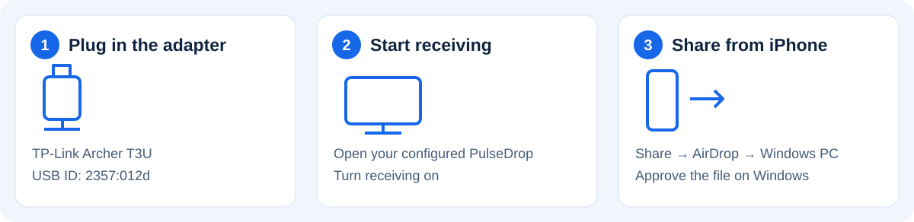
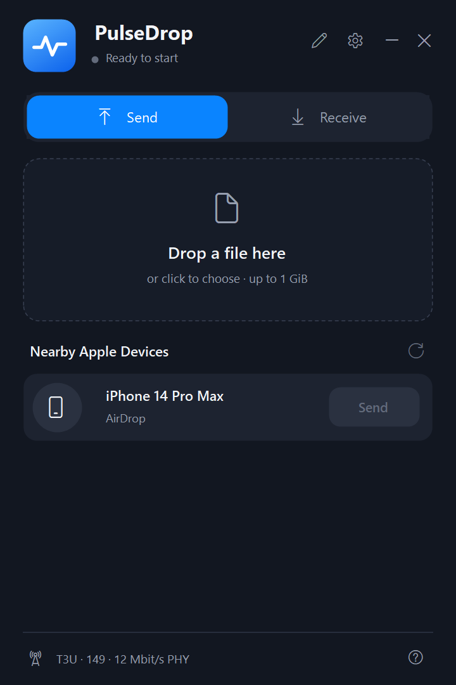
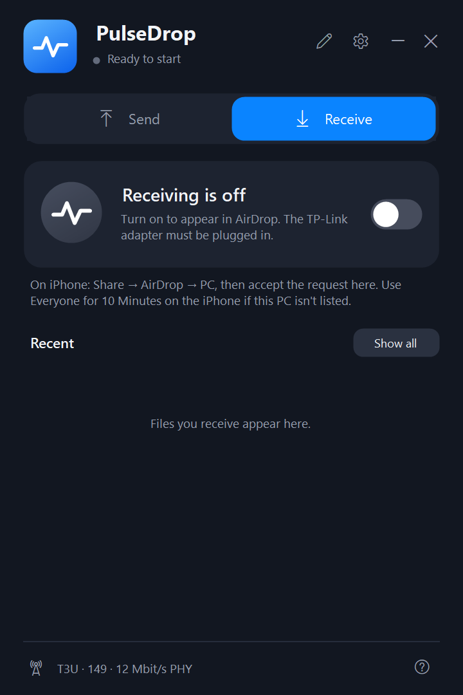

  

  <a href="#what-you-need">What you need</a> ·
  <a href="#get-started">Get started</a> ·
  <a href="#send-a-file">Send a file</a> ·
  <a href="#need-help">Need help?</a> ·
  <a href="docs/build.md">Build from source</a>

**PulseDrop lets a Windows PC exchange files with a nearby iPhone using AirDrop. No iPhone app is needed.**

> **Developer preview:** this needs a specific USB Wi-Fi adapter and administrator setup. It does not work with your PC's built-in Wi-Fi alone. Earlier builds transferred files both ways; the current diagnostic build still needs fresh phone testing. [Current limits →](docs/limitations.md)

## What you need

| On your Windows PC | On your iPhone |
| --- | --- |
| Windows x64; tested on Windows 11 | A nearby, unlocked iPhone |
| **TP-Link Archer T3U — USB ID `2357:012d`** | AirDrop: **Everyone for 10 Minutes** |
| Working Bluetooth | No extra app |
| Administrator access for driver setup | Accept incoming files when asked |

**Check the USB ID, not just the adapter name.** Other hardware revisions are not qualified. Setup also installs/configures a virtual network adapter. The dedicated TP-Link adapter cannot provide normal Wi-Fi while configured for PulseDrop, so keep another internet connection available.

## Get started

1. **Build the development setup.** Follow the [Windows build guide](docs/build.md). There is no qualified public installer attached to this source snapshot. A local installer is a developer test build, not a general release.
2. **Configure the supported adapter.** Plug it in, run setup and approve the administrator prompt. Choose adapter configuration only after checking the USB ID. Close PulseDrop before changing drivers.
3. **Open PulseDrop.** Turn receiving on, then follow the three steps below.

### iPhone → PC

1. On the iPhone, open a photo, video or file.
2. Tap **Share → AirDrop → Windows PC** (or the name you set in PulseDrop).
3. **Accept** the request on Windows. Wait for completion, then use **Received files** to open the saved folder.

### PC → iPhone

1. Unlock the iPhone and refresh **AirDrop → Everyone for 10 Minutes**.
2. In PulseDrop, open **Send** and refresh the device list.
3. Choose a file, select the iPhone and press **Send**.
4. **Accept** on the iPhone and wait for completion.

Keep the phone nearby and unlocked. The app limit is **1 GiB** per transfer; large videos may take several minutes. Keep experimental faster sending and channel matching off for the baseline setup.

## Inside the app

These are real UI renders with **synthetic demo data**, not proof of a live connection or transfer.

<table>
  <tr>
    <td align="center"><strong>Find a device and send</strong> </td>
    <td align="center"><strong>Turn receiving on</strong> </td>
  </tr>
</table>

## Need help?

| What you see | What to try |
| --- | --- |
| iPhone missing | Unlock it, refresh Everyone for 10 Minutes, then refresh PulseDrop. |
| Windows PC missing on iPhone | Check that receiving is on and the supported USB adapter is plugged in. Reopen the AirDrop sheet. |
| Bluetooth recovery offered | It may briefly disconnect Bluetooth accessories. Use it only when you can tolerate that interruption. |
| Transfer paused | Keep both devices nearby and unlocked. Large files can pause; don't stop receiving while a transfer is active. |
| Transfer failed | Cancel the attempt, refresh the phone's Everyone window and device list, then retry. Avoid experimental speed settings. |
| Need normal Wi-Fi on the TP-Link again | Close PulseDrop, then use **Restore USB Wi-Fi driver** from the Start menu. Restoration still needs clean-PC qualification. |

For a bug report, include the revision, adapter USB ID, direction, file size and what appeared on both devices. **Review and redact diagnostic exports before sharing:** they can contain names, addresses, file names and paths. Never post keys, captures or personal files.

## What works — and what still needs testing

Earlier builds completed iPhone-to-PC and PC-to-iPhone transfers, including a **135.6 MB outgoing video**. The 0.2.7 startup fix passed ten adapter start/stop cycles. Current-build phone transfer, Bluetooth coexistence, clean-PC install/restoration and sustained reliability remain open. **Contacts Only is unsupported.** This is not Apple-account identity verification.

[Detailed limitations](docs/limitations.md) · [Architecture](docs/architecture.md) · [Contributing](CONTRIBUTING.md) · [Security reporting](SECURITY.md) · [Privacy](PRIVACY.md) · [Code signing policy](CODE-SIGNING.md)

Signing status: **unsigned**. The SignPath Foundation application was submitted on October 18, 2026; review is pending. No approval or signed release is claimed.

<strong>For developers: source layout and licensing</strong>

| Folder | Purpose |
| --- | --- |
| `desktop/` | Windows UI and helper lifecycle |
| `airdrop/` | HTTPS discovery, consent and file streaming |
| `sched/`, `compat/`, `netif/` | OWL scheduling and virtual network interface |
| `radio/` | Separate USB radio bridge and pipe transport |
| `tools/`, `installer/` | Builds and explicit device configuration |
| `assets/`, `tests/`, `patches/` | Branding, regression tests and upstream changes |

Source defaults to GPL-3.0-or-later with GPL-2.0-only and MIT exceptions. See [LICENSE](LICENSE) and [third-party notices](THIRD_PARTY_NOTICES.md). OWL and devourer remain separate executables. Preserve applicable source/notices when distributing binaries.

PulseDrop is independent of Apple, TP-Link, OpenIPC and the OWL authors. Product names belong to their respective owners.
